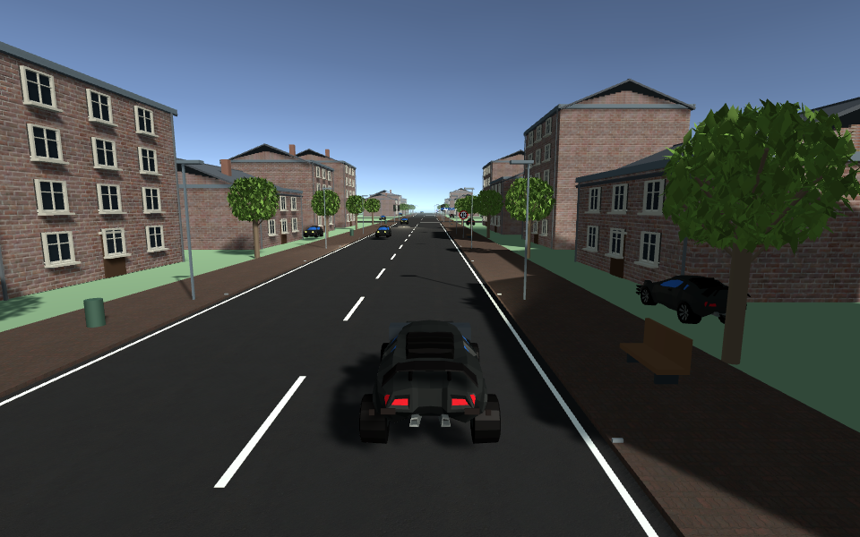
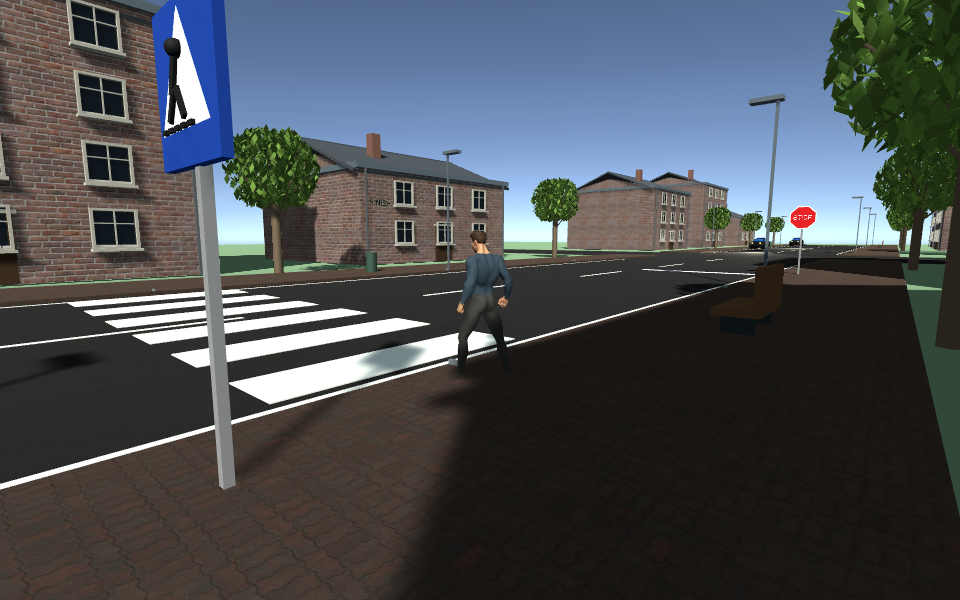

# Realism asset pass

The assets below were acquired and integrated on 7 September 2026. No purchase or account sharing was required. Unity remains 2022.3.62f3 with the Built-in Render Pipeline. The built-in Animation module is now enabled for Humanoid animation.

| Asset | Creator / source | Licence | Integration |
| --- | --- | --- | --- |
| Free Coupe Car | Alexander123, https://opengameart.org/content/3d-car-low-poly-free | CC0, as declared on the asset page | Original meshes/prefab retained under ThirdParty. Materials converted to Standard; scale and orientation adapted. Four separate wheels follow existing WheelCollider pivots. Player, parked and moving cars use the coupe. |
| Universal Base Characters, free Standard edition | Quaternius, https://quaternius.com/packs/universalbasecharacters.html | CC0 1.0; included License_Standard.txt | Male base mesh, eyes, skin texture and parted hair. Original base has superhero proportions; horizontal scale is reduced. Clothing is a material/submesh adaptation, not a separately simulated garment. |
| Universal Animation Library, free Standard edition | Quaternius, https://quaternius.com/packs/universalanimationlibrary.html | CC0 1.0; included Animation-License.txt | Humanoid idle and walking clips blend from measured movement; root motion is disabled because the crossing scenario owns position. |
| Asphalt 01 | Poly Haven, https://polyhaven.com/a/asphalt_01 | CC0 | 1K diffuse and OpenGL normal maps; metric UVs avoid stretching. |
| Brick Pavement | Poly Haven, https://polyhaven.com/a/brick_pavement | CC0 | 1K photographed pavement maps. |
| Red Brick 03 | Poly Haven, https://polyhaven.com/a/red_brick_03 | CC0 | 1K photographed facade maps. |
| European window module, gables, gutters and foliage | Original FahrCheck geometry | Project-authored | Reusable window prefab, mesh leaves and architectural details generated from code. No third-party building kit is implied. |

Poly Haven licence information: https://polyhaven.com/license . Texture download hashes were checked against the provider metadata. Roughness source maps are retained for future material tuning; the current Standard materials use scalar smoothness and normal maps. Powered by Poly Haven for asset metadata access.

This is a first step toward a more believable visual style, not a photorealistic or fully finished art package. The coupe remains a low-poly model; no branded vehicle accuracy or detailed new cockpit interior is claimed. The humanoid uses proper skinning and animation, but clothing and facial detail remain limited. Building layouts still share the existing generated town footprint.

## Files and workflow

- Source assets: `Assets/ThirdParty/FreeCoupeCar`, `Assets/ThirdParty/Quaternius`, `Assets/ThirdParty/PolyHaven`.
- Generated prefabs and meshes: `Assets/FahrCheck/Generated/Realism`.
- Generator integration: `Editor/RealismUpgrade.cs`, `RealismTrees.cs`, `RealismImporter.cs`.
- Runtime animation: `Scripts/SkinnedPedestrianMotion.cs`.
- Checks: `Editor/RealismChecks.cs` and two new runtime animation assertions in `AcademyRuntimeVerification.cs`.

Rebuild through FahrCheck → Open Setup. The generator reconstructs this integration and preserves existing asset identifiers. Avoid editing the generated civilian mesh directly; edit the source/generator or integrate a separately maintained replacement prefab.

## Unity-rendered previews

## Audi R8 player-car replacement

The owner supplied `audi-r8-2017.zip`, containing a nested FBX ZIP and texture RAR. Its ASCII FBX contains 72,290 triangles and imports as 168 mesh renderers. Three textures are supplied; most finishes are material-based.

Model: **Audi R8 2017 by artbyzia**. Source: https://sketchfab.com/3d-models/audi-r8-2017-3702de6c13cb4829afba67aaf2e92963 . Licence: **CC BY 4.0**, https://creativecommons.org/licenses/by/4.0/ . Official Sketchfab API metadata confirms commercial use is allowed with attribution. No creator or manufacturer endorsement is implied; the asset copyright licence does not grant separate manufacturer branding rights.

Adaptations: Standard-shader paint, glass, metal and lamp materials; metre-scale alignment; four grouped wheels fitted to existing WheelColliders; left-hand steering-assembly placement; driver-camera position. The source includes interior geometry. Brakes/calipers are currently grouped with the spinning wheel assemblies; this is a visual simplification. Mirrors are reflective-looking geometry, not live rear-view cameras. Existing scripted traffic retains the lightweight coupe.

The original downloaded files are under `Assets/ThirdParty/ArtbyziaR8`. The generated visual prefab is `Assets/FahrCheck/Generated/Realism/AudiR8Visual.prefab`. The course generator recreates the integration. In-game attribution appears on the welcome screen, and notices ship in `Assets/StreamingAssets/THIRD_PARTY_NOTICES.txt`.

This is the newly supplied Sketchfab model, not the earlier Personal Use Free3D model. The Free3D files were inspected only in temporary storage and were not imported into the project.
